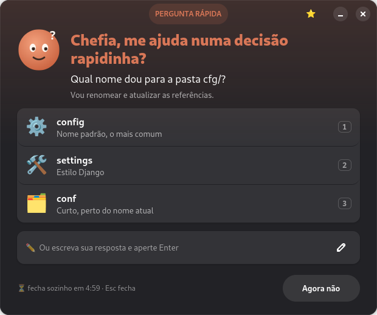
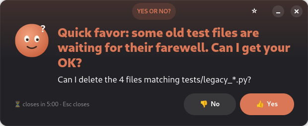
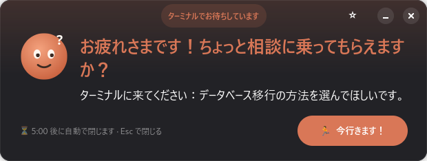

# popup-skill

An agent skill that asks you the task's questions through **desktop pop-up windows**
instead of the terminal, so you can work in another window and still answer.

*Leia em português: [README.pt-BR.md](README.pt-BR.md)*

> **Where it works:** agents that run on your own computer with a screen, such as
> Claude Code on Linux, macOS or Windows. It does **not** work on claude.ai in the
> browser or in cloud sandboxes: there is no desktop there to show a window on.

| Quick question (pt-BR, favorite greeting ⭐) | Yes / no (en) | Call to the terminal (ja) |
|---|---|---|
|  |  |  |

## What it does

- **Three kinds of pop-up:** a direct question with option cards and a free-text field,
  a yes/no question, and a "come to the terminal" call for questions that need context.
- **Every pop-up opens with a light, friendly greeting** written by the agent for the
  moment. The question below it stays complete and serious.
- **Works across desktops.** The script picks the interface at run time:

  | System | Order tried |
  |---|---|
  | Linux (GNOME, XFCE…) | GTK4 + libadwaita → zenity → kdialog → Tkinter |
  | Linux (KDE, LXQt) | kdialog → GTK4 + libadwaita → zenity → Tkinter |
  | macOS | osascript → Tkinter |
  | Windows | WPF via PowerShell 5.1 (cards, mascot, color emoji) → Tkinter → PowerShell (WinForms) |
  | WSL | native Windows window via `powershell.exe` (WinForms) → GTK4 → zenity → kdialog → Tkinter |

  On native Windows the default is a WPF window with the same layout as the GTK one:
  option cards, the mascot, color emoji, and the 1–9 shortcuts. It follows the Windows
  light/dark setting. The four small DLLs it needs ship inside the skill
  (`assets/wpf/`, about 1.8 MB), so there is nothing for the user to install: Windows'
  own PowerShell 5.1 runs it. If those DLLs or PowerShell are missing, the script falls
  back to Tkinter and then to the simpler WinForms window (black-and-white emoji).

  On WSL the window opens on Windows itself, so it works without WSLg or Linux GUI
  packages; WSL keeps using the WinForms window. No screen at all (SSH, CI) → exit 6,
  and the agent asks in the terminal instead.
- **10 languages for the window texts:** pt-BR, pt-PT, en, es, fr, de, it, ru, zh, ja
  (others fall back to English). The agent writes the greeting and question in *your*
  language and passes `--lang`.
- **Favorite greetings.** Keep the ones you like in a file, add them with the ⭐ in the
  window, and the script enforces the rules: no greeting repeated in a task, never two
  favorites in a row, favorites only in their own language.

## Install

### Claude Code (plugin)

```
/plugin marketplace add JVMartyns/popup-skill
/plugin install popup@popup-skill        # manual: runs only when you type /popup (full name: /popup:popup)
# or
/plugin install popup-auto@popup-skill   # Claude may turn it on when you say you'll be away
```

Install one of the two. You can switch later with `/plugin`.

### Claude Code (plain skill folder)

```bash
git clone https://github.com/JVMartyns/popup-skill
cp -r popup-skill/skills/popup ~/.claude/skills/
```

This copy lets Claude turn it on by itself when it fits. To make it manual-only
(`/popup`), add to `~/.claude/settings.json` (or the project's `.claude/settings.json`):

```json
{ "skillOverrides": { "popup": "user-invocable-only" } }
```

### Cursor

Clone the repository and link the skill into Cursor's skills folder:

```bash
git clone https://github.com/JVMartyns/popup-skill
mkdir -p ~/.cursor/skills
ln -sfn "$PWD/popup-skill/skills/popup" ~/.cursor/skills/popup
```

For a single project, use `.cursor/skills/` at the project root instead. To copy
instead of linking: `cp -r popup-skill/skills/popup ~/.cursor/skills/`. On Windows,
the folder is `%USERPROFILE%\.cursor\skills\popup`.

Reload the Cursor window (`Ctrl+Shift+P` → **Developer: Reload Window**) and, in
chat, type `/popup` and the request.

In the Cursor Flatpak, the agent shell runs inside the sandbox, where GTK/PyGObject
and Tkinter are usually unavailable; zenity is bundled, so the window falls back to
the simple-list version. Outside Flatpak, the GTK window is used.

### Other agents (Codex, Gemini CLI, Pi…)

Copy `skills/popup/` into the agent's skills folder (see its docs). If the agent does
not load skills, paste `SKILL.md` into its instructions file (`AGENTS.md`, `GEMINI.md`…)
and replace `SKILL_DIR` with the absolute path of the folder. Set `POPUP_AGENT` to the
agent's name to show it in the window title.

## Requirements

Python 3 and a graphical session. Each interface needs its own tool:
GTK4 + libadwaita + PyGObject (best look), or `zenity`, or `kdialog`, or Tkinter;
macOS and Windows use built-in `osascript` / PowerShell. On Windows, the WPF window
uses the DLLs bundled in `skills/popup/assets/wpf/` and PowerShell 5.1, both already
present; the WinForms fallback needs only PowerShell. Optional: `notify-send`,
`canberra-gtk-play` (sound).

Check what would be used, without opening a window:

```bash
skills/popup/popup.py doctor
```

## Usage (what the agent runs)

You don't type these: the agent does, with the full path that `SKILL.md` gives it.
To run the script yourself, see [Running the script yourself](#running-the-script-yourself).

```bash
popup.py ask      --lang en --timeout 300 \
  --greeting "Hey, got a sec? I'm stuck on a quick choice." \
  --question "Which name should the cfg/ folder get?" \
  --option "⚙️|config|Standard name" --option "🛠️|settings|Django style"

popup.py yesno    --lang en --greeting "..." --question "Delete the 4 legacy test files?"
popup.py terminal --lang en --greeting "..." --question "Please come to the terminal: ..."
```

The answer goes to stdout (`yesno` prints `yes`/`no`, `terminal` prints `ok`). Exit codes: `0` answered, `1` closed / "Not now" / "No",
`5` timeout, `6` no screen or no interface (ask in the terminal), `7` greeting refused
(repeated or favorite rule): write another one and run again.

Options: `--lang CODE`, `--backend gtk,zenity,…` (or `POPUP_BACKEND`), `--timeout S`,
`--context TEXT`, `--no-other` (no free-text field).

Run `popup.py --help` for all options.

Coming from 0.1? The Portuguese names (`pergunta`, `simnao`, `--chamada`, `--idioma`,
`POPUP_IDIOMA`…) still work as hidden aliases, and `~/.config/popup/favoritas.txt` is
renamed to `favorites.txt` on first use. Only the `yesno` output changed: `sim`/`não`
is now `yes`/`no` (the exit code is the same).

## Favorite greetings

The easiest way is to ask the agent: *"save this greeting as a favorite"*, *"show my
favorites"*. It already knows where the script is. Or click the ⭐ in the GTK or WPF
window.
From a shell (see the next section for `$POPUP`):

```bash
$POPUP favorite list [--lang pt-BR]
$POPUP favorite add --lang pt-BR "Chefia, me ajuda numa decisão rapidinha?"
$POPUP favorite rm  --lang pt-BR "Chefia, me ajuda numa decisão rapidinha?"
```

The file lives outside the skill folder, so updates
never erase it: `~/.config/popup/favorites.txt` (Windows: `%APPDATA%\popup\favorites.txt`;
override with `POPUP_FAVORITES`). One greeting per line, in sections per language
(`[pt-BR]`, `[en]`…). Task history: `~/.local/state/popup/historico.json`
(a task ends after 2 hours without pop-ups in that folder).

## Running the script yourself

The script is not on your `PATH`. Its location depends on how you installed it:

```bash
# plugin (the folder name changes with the version)
POPUP=$(ls -d ~/.claude/plugins/cache/popup-skill/*/*/skills/popup | sort -V | tail -1)/popup.py
# plain skill folder
POPUP=~/.claude/skills/popup/popup.py

$POPUP doctor     # which interface and language would be used, without a window
$POPUP --help
```

## What it runs and writes on your machine

Everything stays on your computer. The skill makes **no network requests** and
collects no data. See [PRIVACY.md](PRIVACY.md).

- **Runs:** Python 3; one dialog tool from the table above (GTK through PyGObject,
  `zenity`, `kdialog`, `osascript`, `powershell` — on Windows and WSL, `powershell.exe` —
  or Tkinter); `git branch --show-current`
  to show the branch in the window title; optionally `canberra-gtk-play` (Linux),
  `afplay` (macOS) or a system beep (Windows) for the sound. The agent may also run
  `notify-send` when a question is left unanswered. On native Windows the WPF window
  loads the DLLs from `skills/popup/assets/wpf/` into PowerShell.
- **Writes:** `~/.config/popup/favorites.txt` (your favorite greetings) and
  `~/.local/state/popup/historico.json` (greetings shown per working folder, kept for
  2 hours to enforce the repetition rules). On Windows: `%APPDATA%\popup\` and
  `%LOCALAPPDATA%\popup\`. The WPF window writes its generated `.ps1` (UTF-8 with BOM)
  and, when you click the ⭐, a small control file to the user's temp folder; both are
  deleted right after the window closes. The WinForms fallback writes no files: its
  script and texts go inline in the command (`-EncodedCommand`).
- **Reads:** environment variables listed above, the locale, and those two files.

## Development

`skills/popup/` is the single source. `plugins/` is generated from it:

```bash
python3 scripts/build.py          # regenerate plugins/popup and plugins/popup-auto
python3 tests/teste.py            # 123 tests, no window (fake zenity/kdialog/powershell)
```

CI runs both (`scripts/build.py --check` fails if `plugins/` is out of date).
`tests/manual/screenshot_gtk.py` renders the GTK window to a PNG. The WPF tests
simulate native Windows (`popup.WINDOWS = True`) and check the generated `.ps1`,
the WPF data/XAML, the DLL order, the fallbacks and the doctor output; they do not
open a window.

Tested on real hardware: GNOME (GTK and zenity) and WSL (native Windows WinForms
window). The WPF window was built from the approved preview but has not been run on
native Windows hardware yet. Untested so far: kdialog, osascript (macOS), and native
Windows WPF/Tkinter. If you can try one of them, [docs/TESTING.md](docs/TESTING.md)
has a 5-minute checklist. Reports welcome.

## License

[MIT](LICENSE)
