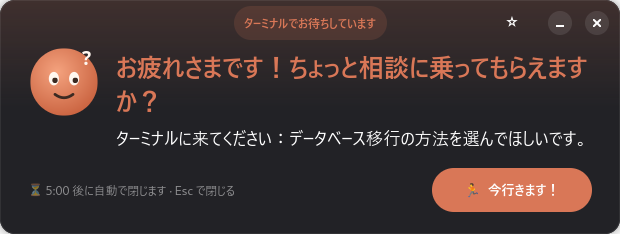

# popup-skill

Uma skill para agentes que faz as perguntas da tarefa por **pop-up na área de trabalho**,
em vez do terminal. Você pode trabalhar em outra janela e responder mesmo assim.

*Read in English: [README.md](README.md)*

| Pergunta rápida (pt-BR, chamada favorita ⭐) | Sim ou não (en) | Chamada ao terminal (ja) |
|---|---|---|
|  |  |  |

## O que faz

- **Três tipos de pop-up:** pergunta direta com cartões de opção e campo para escrever,
  sim ou não, e "venha ao terminal" para dúvidas que precisam de contexto.
- **Todo pop-up abre com uma chamada leve e simpática**, escrita pelo agente para o
  momento. A pergunta logo abaixo vem inteira e séria.
- **Funciona em vários desktops.** O script escolhe a interface na hora:

  | Sistema | Ordem das tentativas |
  |---|---|
  | Linux (GNOME, XFCE…) | GTK4 + libadwaita → zenity → kdialog → Tkinter |
  | Linux (KDE, LXQt) | kdialog → GTK4 + libadwaita → zenity → Tkinter |
  | macOS | osascript → Tkinter |
  | Windows | Tkinter → PowerShell (WinForms) |

  Sem tela (SSH, CI) → exit 6, e o agente pergunta no terminal.
- **Textos da janela em 10 idiomas:** pt-BR, pt-PT, en, es, fr, de, it, ru, zh, ja
  (os outros saem em inglês). O agente escreve a chamada e a pergunta no *seu* idioma e
  passa `--lang`.
- **Chamadas favoritas.** Guarde as que você gosta num arquivo ou com a ⭐ da janela. O
  script aplica as regras: nenhuma chamada repetida na tarefa, nunca duas favoritas
  seguidas, favorita só no idioma dela.

## Instalação

### Claude Code (plugin)

```
/plugin marketplace add JVMartyns/popup-skill
/plugin install popup@popup-skill        # manual: só roda quando você digita /popup
# ou
/plugin install popup-auto@popup-skill   # o Claude pode ativar quando você disser que vai sair
```

Instale um dos dois. Dá para trocar depois pelo `/plugin`.

### Claude Code (pasta de skill)

```bash
git clone https://github.com/JVMartyns/popup-skill
cp -r popup-skill/skills/popup ~/.claude/skills/
```

Essa cópia deixa o Claude ativar a skill sozinho quando fizer sentido. Para ela só
rodar com `/popup`, acrescente em `~/.claude/settings.json`:

```json
{ "skillOverrides": { "popup": "user-invocable-only" } }
```

### Outros agentes (Codex, Gemini CLI, Cursor, Pi…)

Copie `skills/popup/` para a pasta de skills do agente (veja a documentação dele). Se
ele não carregar skills, cole o `SKILL.md` nas instruções dele (`AGENTS.md`,
`GEMINI.md`…) e troque `SKILL_DIR` pelo caminho absoluto da pasta. Defina `POPUP_AGENT`
com o nome do agente para ele aparecer no título da janela.

## Requisitos

Python 3 e uma sessão gráfica. Cada interface precisa da sua ferramenta:
GTK4 + libadwaita + PyGObject (o visual mais completo), ou `zenity`, ou `kdialog`, ou
Tkinter; macOS e Windows usam `osascript` / PowerShell, que já vêm no sistema.
Opcionais: `notify-send`, `canberra-gtk-play` (som).

Para ver o que seria usado, sem abrir janela:

```bash
skills/popup/popup.py doctor
```

## Uso (o que o agente roda)

```bash
popup.py ask      --lang pt-BR --timeout 300 \
  --greeting "Opa, tem um minutinho? Empaquei numa escolha." \
  --question "Qual nome dou para a pasta cfg/?" \
  --option "⚙️|config|Nome padrão" --option "🛠️|settings|Estilo Django"

popup.py yesno    --lang pt-BR --greeting "..." --question "Apago os 4 testes antigos?"
popup.py terminal --lang pt-BR --greeting "..." --question "Preciso de você no terminal: ..."
```

A resposta sai no stdout (`yesno` imprime `yes`/`no`, `terminal` imprime `ok`). Exit: `0` respondeu, `1` fechou / "Agora não" / "Não",
`5` timeout, `6` sem tela ou sem interface (pergunte no terminal), `7` chamada recusada
(repetida ou regra de favorita): escreva outra e rode de novo.

Opções: `--lang CÓDIGO`, `--backend gtk,zenity,…` (ou `POPUP_BACKEND`),
`--timeout S`, `--context TEXTO`, `--no-other` (sem campo para escrever).

`popup.py --help` mostra todas as opções.

Vindo da 0.1? Os nomes em português (`pergunta`, `simnao`, `--chamada`, `--idioma`,
`POPUP_IDIOMA`…) continuam funcionando como apelidos escondidos, e
`~/.config/popup/favoritas.txt` vira `favorites.txt` no primeiro uso. Só a saída do
`yesno` mudou: `sim`/`não` agora é `yes`/`no` (o exit code é o mesmo).

## Chamadas favoritas

```bash
popup.py favorite list [--lang pt-BR]
popup.py favorite add --lang pt-BR "Chefia, me ajuda numa decisão rapidinha?"
popup.py favorite rm  --lang pt-BR "Chefia, me ajuda numa decisão rapidinha?"
```

Ou clique na ⭐ da janela GTK. O arquivo fica fora da pasta da skill, para não ser
apagado nas atualizações: `~/.config/popup/favorites.txt` (Windows:
`%APPDATA%\popup\favorites.txt`; dá para trocar com `POPUP_FAVORITES`). Uma chamada por
linha, em seções por idioma (`[pt-BR]`, `[en]`…). Histórico das tarefas:
`~/.local/state/popup/historico.json` (uma tarefa termina depois de 2 horas sem pop-up
naquela pasta).

## Desenvolvimento

`skills/popup/` é a fonte única. `plugins/` é gerado a partir dela:

```bash
python3 scripts/build.py          # gera plugins/popup e plugins/popup-auto
python3 tests/teste.py            # 69 testes, sem janela (zenity/kdialog falsos)
```

O CI roda os dois (`scripts/build.py --check` falha se `plugins/` estiver desatualizado).
`tests/manual/screenshot_gtk.py` desenha a janela GTK num PNG.

Ainda não testados em máquina real: kdialog, osascript (macOS) e PowerShell (Windows).
Relatos são bem-vindos.

## Licença

[MIT](LICENSE)
